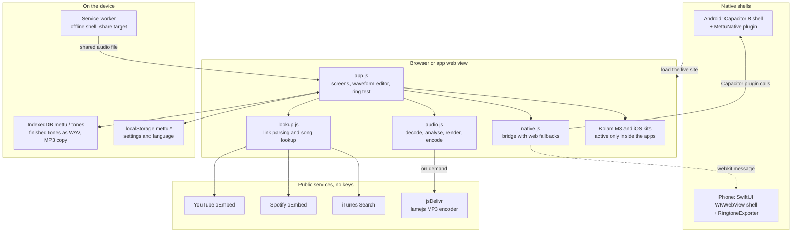
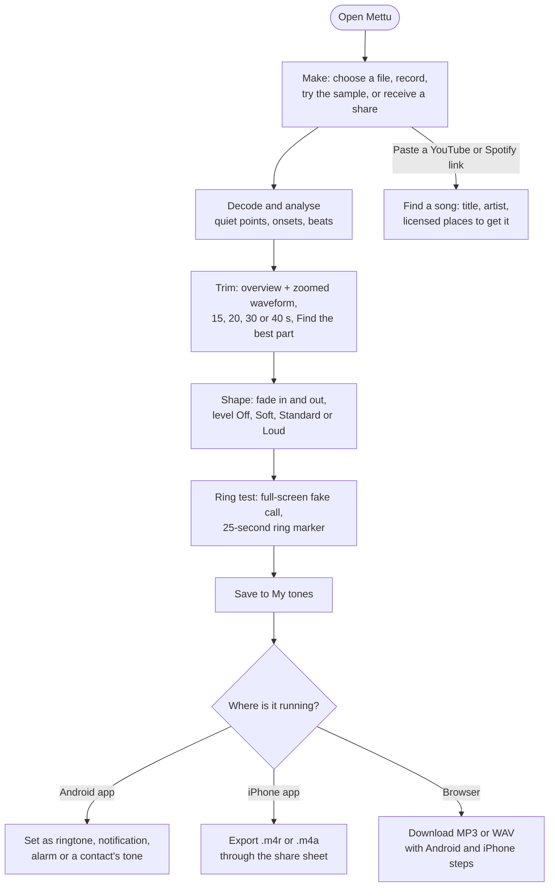
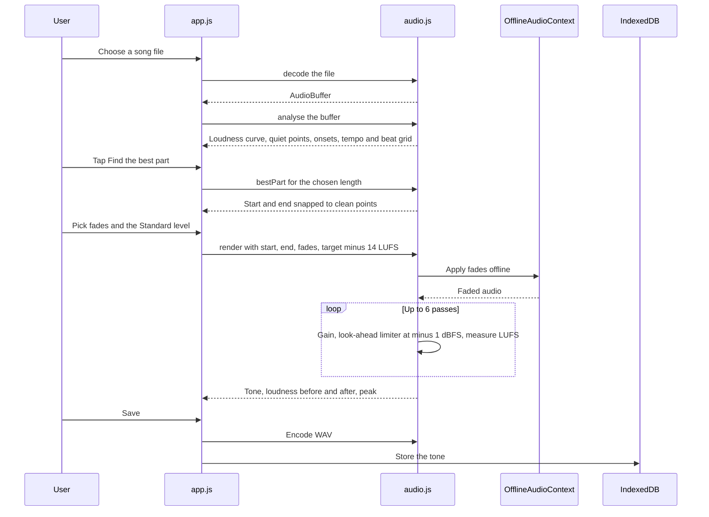
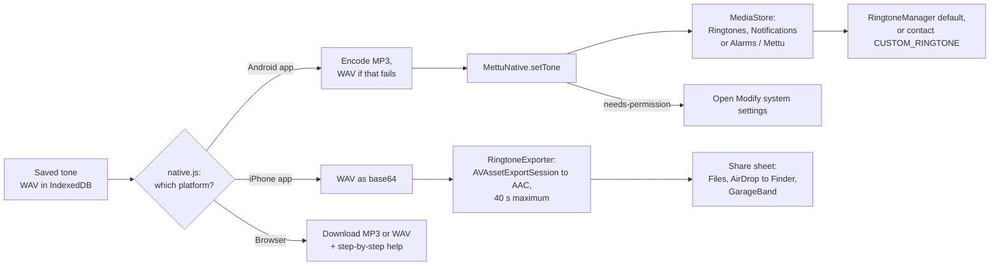
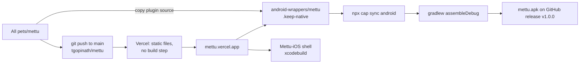

# Mettu (மெட்டு)

Mettu is a ringtone studio in English and Tamil. You bring in a song you already have (a file, a share from another app, or a microphone recording), trim the part you love on a waveform that snaps to quiet points and beats, fade and level it, hear it on a pretend incoming call, and set it as your ringtone, alarm, notification or one contact's tone. All audio work happens on the device with the Web Audio API; nothing is uploaded and there is no account. The engineering idea is "one web app, three honest endings": the Android app sets the tone through a small native plugin, the iPhone app exports a real `.m4r` ringtone file (Apple lets no app set the ringtone), and the website downloads a levelled MP3 or WAV with clear steps.

| Platforms | Stack | Data | Hosting |
|---|---|---|---|
| Web PWA (share target), Android app (Capacitor shell + native plugin), iPhone app (SwiftUI shell + ringtone exporter) | Plain HTML, CSS and classic scripts; Web Audio and OfflineAudioContext; Kolam design system | The user's own audio in IndexedDB; YouTube and Spotify oEmbed and iTunes Search for naming songs | Vercel (mettu.vercel.app), APK on GitHub Releases |

## System architecture

`index.html` loads six classic scripts in order: `i18n.js`, `audio.js`, `lookup.js`, `store.js`, `native.js` and `app.js`. Each exposes one object (`I18N`, `Audio2`, `Lookup`, `Store`, `Native`) that `app.js` uses. There is no server code at all. The native shells add the platform abilities a browser lacks: on Android a Capacitor plugin called `MettuNative`, on iPhone a `ringtone` script-message handler.

*Static site on Vercel with no functions. Song lookups only fetch titles and artists; Mettu never downloads audio from any service.*

## Main user flow

The core job is "make the best 20 to 30 seconds of a song my ringtone". A stepper walks the user through Trim, Shape and Ring test, then the tone is saved to My tones and set.

*Instagram links are recognised but honestly reported as not identifiable.*

## Data flow and state

### From a song to a levelled tone

*Level targets are Soft minus 18, Standard minus 14 and Loud minus 10 LUFS. The render stops when it is within 0.4 LU of the target or the gain reaches 16 times.*

### How the audio engine decides

| Step | Method in `audio.js` |
|---|---|
| Quiet points | Loudness in frames of about 11.6 ms, smoothed over about 60 ms; local minima become snap targets |
| Onsets | Rectified rise in high-frequency log energy |
| Tempo and beats | Autocorrelation of onset strength between 60 and 180 BPM, with a mild preference near 110, plus a confidence score |
| Snapping | Nearest quiet point, beat or onset within range; quiet points win ties for starts and ends |
| Best part | Scores every candidate start: 55 percent loudness in the first 10 seconds (calls are answered quickly), 45 percent loudness over the whole clip, a penalty for starting in the intro |
| Loudness | BS.1770-style K-weighting through an OfflineAudioContext, gated; an approximation, as the code says |
| Limiter | 5 ms look-ahead peak limiter, so "Loud" gets loud without clipping |
| Encoding | WAV written in the page; MP3 through lamejs 1.2.1, loaded from jsDelivr only when first needed |
| Sample tune | A 48-second piece synthesised in the page, so there are no licence questions |
| Recording | `MediaRecorder` from the microphone |

### Setting the tone on each platform

### Where state lives

| Store | Key or name | What it holds |
|---|---|---|
| IndexedDB | database `mettu`, store `tones` | Each saved tone: id, name, created time, duration, LUFS, source file name, WAV blob and, once made, an MP3 copy |
| localStorage | `mettu.lang`, `mettu.len`, `mettu.snap`, `mettu.fadeIn`, `mettu.fadeOut`, `mettu.level` | Language and the last editor settings |
| Cache Storage | `mettu-shell-v4-ios` | App files, fonts, lamejs and the Kolam kits |
| Cache Storage | `mettu-share` | One file shared to the installed PWA, held until the page picks it up |
| Memory only | `S` in `app.js` | The open song's buffer, analysis and selection |

## Key modules

| File / module | Responsibility |
|---|---|
| `index.html` | Header, navigation, live region, dialog and call layers; loads the Kolam CSS, the M3 and iOS kits and the six scripts |
| `app.js` | About 850 lines: screens Make, Editor (Trim, Shape, Ring test), My tones, Find a song, About; waveform drawing with keyboard-operable handles (`role="slider"`); share intake; Android and iOS app modes |
| `audio.js` | The audio engine described above |
| `lookup.js` | Parses YouTube, YouTube Music, Spotify and Instagram links; names the song through oEmbed and iTunes Search; lists licensed stores (YouTube Music, Spotify, JioSaavn, Apple Music, Amazon Music) |
| `store.js` | Tiny IndexedDB wrapper: all, get, put, remove |
| `native.js` | Bridge to `MettuNative`: setTone, pickContact, playRing, stopRing, ringVolume, getShared, open settings |
| `i18n.js` | English and Tamil interface text, including iOS-specific wording |
| `sw.js` | Offline shell and the Web Share Target handler |
| `android/` | Source copy of the native plugin, manifest and Capacitor config; the build project is `android-wrappers/mettu` |
| `tools/shots.mjs` | Portfolio screenshots |

## Platforms

### Web and PWA

Built on the Kolam design system (`kolam/tokens.css` and `kolam/kolam.css`, Lato, 8-point grid), overriding only the primary colour family with Mettu violet `#5a3ec8`. The manifest declares a share target, so on Android the installed PWA appears in the share sheet for audio and video files and links.

### Android app

A Capacitor 8 shell in `android-wrappers/mettu` (app id `com.gopinath.mettu`) that loads `https://mettu.vercel.app`, plus the hand-written `MettuNativePlugin.java`:

- **Share intake:** intent filters for `audio/*` and `video/*` ("Make a ringtone") and `text/plain` links ("Name this song"), and opening audio files.
- **Set the tone:** saves the file to MediaStore in Ringtones, Notifications or Alarms under a `Mettu` folder, then makes it the default through `RingtoneManager` (`setActualDefaultRingtoneUri`). This needs the "Modify system settings" permission, which the app explains and opens for the user.
- **One contact's tone:** contact picker, then `CUSTOM_RINGTONE` on that contact (needs contacts permission).
- **Ring test:** plays on the ring stream (`USAGE_NOTIFICATION_RINGTONE`) at ring volume.

Inside the app the Kolam M3 kit sets `html.k-android` and `app.js` builds the Material 3 app bar and navigation bar (Make, Find a song, My tones, About).

### iPhone app

A SwiftUI `WKWebView` shell in `Mettu-iOS` from the Kolam iOS template, plus `RingtoneExporter`: the page posts the finished WAV, the shell converts it to AAC with `AVAssetExportSession` (cut to 40 seconds, the iPhone ringtone limit), names it `.m4r` (or `.m4a` for GarageBand) and opens the share sheet. The page then shows the Finder and GarageBand steps in an iOS sheet. The Kolam iOS kit sets `html.k-ios` for large titles, a tab bar and iOS buttons.

## Data sources and APIs

| Source | Used for | Licence / key |
|---|---|---|
| The user's own audio | Everything the app edits | Stays on the device |
| YouTube oEmbed | Title and channel of a pasted YouTube link | Free, no key, CORS-enabled |
| Spotify oEmbed | Title of a pasted Spotify link | Free, no key, CORS-enabled |
| iTunes Search API | Best catalogue match (country IN) for the title | Free, no key |
| jsDelivr | `lamejs@1.2.1` MP3 encoder | Free CDN |

## Offline, performance, privacy and accessibility

- **Offline:** after the first visit the whole studio works offline; only song naming needs the network. The service worker fetches app files from the network first and falls back to the cache.
- **Speed:** decoding, analysis and rendering run in the page; the MP3 encoder loads only when someone first needs an MP3, and the MP3 copy is cached on the tone.
- **Privacy:** no account, no upload, no analytics. `vercel.json` sends a `Permissions-Policy` allowing only the microphone (camera and location off), plus `nosniff` and a strict referrer policy.
- **Honesty:** Mettu never downloads or rips audio from YouTube, Spotify or Instagram; it only names the song and links to licensed stores.
- **Accessibility:** the waveform handles are keyboard sliders with labels, announcements go through a live region, the ring test is a labelled modal dialog, and Kolam keeps WCAG AA contrast in light, dark and contrast themes.

## Build and deploy

*The web part of both apps updates with every push; only native changes (the plugin or the exporter) need a new APK or iOS build.*

## Known limits and next steps

- Loudness is an approximation of BS.1770 written in the page, not a certified meter.
- The original brief left iPhone ringtone support out of scope; the iOS exporter was added later, and the user still has to finish in Finder or GarageBand because iOS allows nothing more.
- The APK is a debug build, installed by side-loading; the "Modify system settings" step is an extra screen some users will find confusing.
- `android/` in this repo is a copy of the plugin; the build happens in a separate folder, so the two must be kept in step by hand.
- Tones are stored as WAV, which uses more space than needed; storing only the MP3 or AAC would be lighter.
- There is no audio fingerprinting ("listen and identify"), by design for v1.

---

Written from the source code on 17 November 2026. Source: [github.com/tgopinath/mettu](https://github.com/tgopinath/mettu) (web app and plugin source) and [github.com/tgopinath/Mettu-iOS](https://github.com/tgopinath/Mettu-iOS) (iPhone shell).
